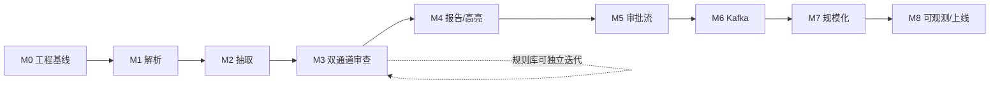

# ContractForge 开发路线与里程碑

> 版本 **v1.0** ｜ 2026-10-24 ｜ 对应架构文档 `docs/项目架构.md` v4
> 一句话目标：**把「AI 审查结果」做成一个能进审批流、能追溯、能审计、能扛量的生产级系统**，
> 而不是一个跑得起来的 demo。

---

## 0 文档说明

### 0.1 文档结构（本文的目录树）

```
开发路线与里程碑.md
├─ 0 文档说明
│  ├─ 0.1 文档结构（本节）
│  ├─ 0.2 阅读路径（按角色）
│  └─ 0.3 维护机制（版本 / 变更 / 关联文档）
├─ 1 路线图总览
│  ├─ 1.1 目标与成功标准（Definition of Success）
│  ├─ 1.2 三条主线（业务闭环 / 工程基线 / 规模与债务）
│  ├─ 1.3 里程碑全景（M0–M8 + 依赖关系）
│  └─ 1.4 阶段门与发布节奏（Gate / 演示 / 回滚）
├─ 2 技术基线（2026 主流 + 生产规范）
│  ├─ 2.1 分层选型矩阵（选型 / 版本 / 依据 / 备选）
│  ├─ 2.2 架构决策记录 ADR 清单
│  └─ 2.3 明确「不用什么」与原因
├─ 3 里程碑详解（M0–M8）
│  └─ 每个里程碑：目标 / 范围 / 交付物 / 验收 DoD / 演示脚本 / 风险
├─ 4 工程规范（生产级）
│  ├─ 4.1 分支、提交与评审
│  ├─ 4.2 CI 七道门禁
│  ├─ 4.3 测试策略（含 AI 评测回归）
│  ├─ 4.4 分层契约与代码结构
│  ├─ 4.5 数据库演进（expand-contract）
│  ├─ 4.6 AI 工程规范（prompt / 结构化输出 / 成本 / 脱敏）
│  └─ 4.7 安全与合规
├─ 5 质量指标与 SLO
├─ 6 风险登记册
└─ 7 附录（目标目录树 / DoD 模板 / 参考）
```

### 0.2 阅读路径

| 角色 | 建议读法 |
|---|---|
| 自己（执行者） | 1.3 → 3（当前里程碑）→ 4.2 / 4.3（每天要看） |
| 面试官 / 评审 | 1.1 → 2.1 → 3 的 DoD → 5（SLO 与数据） |
| 未来协作者 | 0 → 2 → 4（规范先行） |

### 0.3 维护机制

- **单一事实源**：架构"是什么"看 `docs/项目架构.md`；"按什么顺序做、做到什么算完"看本文。
- **变更方式**：里程碑范围变更必须改本文并记 `附录 C 变更记录`；技术选型变更必须新增 ADR。
- **节奏**：每个里程碑收尾时回写「实际产出 / 偏差 / 下一步」，不做事后补写的漂亮文档。

---

## 1 路线图总览

### 1.1 目标与成功标准

| 维度 | 成功标准（可验证） |
|---|---|
| 业务 | 一份真实合同从上传到审批通过，全流程走通，每一步有操作人、时间、意见 |
| 可信 | 每条风险点都带「原文定位 + 判定依据 + 修改建议」，法务可一键确认/驳回 |
| 工程 | 同步接口 P95 < 300ms，长任务全部异步，任务成功率 ≥ 99% |
| 规模 | 100 万合同数据下列表查询 P95 < 200ms，压测有前后对比数据 |
| 可观测 | 一条 trace 能还原一次审查的每一步（含模型、token、成本） |
| 交付 | `docker compose up` 一键起全栈；CI 七道门禁全绿 |

> **成功标准的写法很关键**：全部可量化、可当场演示。做不到的先不写进标准，写进「不做清单」。

### 1.2 三条主线

```
主线 A｜业务闭环（保底，必须先完成）
  M1 解析 → M2 抽取 → M3 双通道审查 → M4 报告/高亮 → M5 审批流
  产出：一个真的能用的合同审查系统

主线 B｜工程基线（贯穿，不定时补就变技术债）
  M0 骨架/规范/CI → 每个 M 的质量门禁 → M8 可观测与上线
  产出：一个"敢让别人接手"的代码库

主线 C｜规模与技术债（业务闭环完成后再注入，每步要数据）
  M6 Kafka 事件化 → M7 压测/限流/分库分表/冷热分离
  产出：面试可讲的"真实压力下长出来的架构"
```

**纪律**：A 未完不碰 C。C 的每一步必须先有压力（压测 / 灌数据），再谈优化——没有压力的"分布式设计"是死代码。

### 1.3 里程碑全景

| 里程碑 | 主题 | 周期（周） | 对应架构阶段 | 主轨 |
|---|---|---|---|---|
| **M0** | 工程基线：骨架 · 规范 · CI · 本地全栈 | W1 | 前置 | B |
| **M1** | 合同解析与条款结构化（含 OCR） | W2–W3 | C0 | A |
| **M2** | 要素抽取（结构化输出） | W4 | C1 | A |
| **M3** | 双通道审查（规则 + LLM） | W5–W6 | C2 | A |
| **M4** | 审查报告与前端高亮标注 | W7–W8 | C3 | A |
| **M5** | 审批工作流与权限（并发正确性） | W9–W10 | C4 | A |
| **M6** | 异步与事件化（Kafka 流水线） | W11–W12 | 债务阶段 1 | C |
| **M7** | 规模化：压测 · 限流 · 数据治理 | W13–W14 | 债务阶段 2–3 | C |
| **M8** | 可观测性与生产上线 | W15–W16 | C5 / 债务阶段 4 | B |

**周期假设**：单人、每周 15–20 小时。若全职投入，前 5 个里程碑可压缩到 4–5 周；**不要压缩 M3 和 M5**——这两个是本项目的技术含量所在。

**依赖关系**：



### 1.4 阶段门与发布节奏

每个里程碑结束必须过 **Gate**，否则不进入下一个：

| Gate | 判定条件 | 不过怎么办 |
|---|---|---|
| G1 能跑 | `docker compose up` 起得来，主链路可演示 | 停下来补，不带病前进 |
| G2 可测 | 新增核心逻辑单测覆盖 ≥ 80%，CI 全绿 | 补测试，不允许"先合并后补" |
| G3 可证 | 有量化数据（准确率 / P95 / 成功率）写进本文 | 没有数据 = 没做完 |
| G4 可读 | README / 接口文档 / ADR 同步更新 | 文档缺失算未完成 |

**发布策略**：M1–M5 为内部迭代（`main` 常绿 + tag `v0.x`）；M6 起每个里程碑产出可演示版本（`v1.0` = M5 完成，`v1.5` = M8）。

---

## 2 技术基线（2026 主流 + 生产规范）

### 2.1 分层选型矩阵

> 原则：**2026 年企业新项目的默认解**，而不是"我用过最熟的"。每行都能回答"为什么不用备选"。
>
> **每项选型必须标注它属于哪一层（本版新增，防止纸上谈兵）：**
> - **【当前实现】**：在单机 32G + 单人 + 每天几百份合同的真实约束下，本里程碑内真正要落地并跑通的。
> - **【演进叙事】**：量级上来后才需要，或面试可讲的架构储备；**当前量级不上，只做设计与 ADR**，避免"为了堆技术而堆技术"。
>
> 这两层的区分，是回答"你的架构是不是纸上谈兵"的关键——**一个选型如果标了【演进叙事】，就不能在验收里要求它跑通**。

| 层 | 选型 | 版本基线 | 2026 主流依据 | 备选 / 淘汰理由 |
|---|---|---|---|---|
| 语言 | Python | 3.13（3.14 可评估） | 3.13 稳定、生态齐全；3.14 的 t-string / 子解释器对 prompt 拼接与隔离有价值，但生态仍需观察 | 3.11 已非新项目首选 |
| 包管理 | **uv** | ≥0.5 | Rust 实现、锁文件确定性、CI 从分钟级到秒级，已是 2026 新项目默认 | pip / poetry：慢、锁不严 |
| Lint/Format | **ruff** | ≥0.8 | 一个工具替代 black+isort+flake8 | 多工具拼装已淘汰 |
| 类型检查 | **pyright(IDE) + mypy(CI)** | 最新 | 业界稳定组合：IDE 快反馈、CI 严格把关 | 只用一个会漏 |
| Web 框架 | **FastAPI** | ≥0.115 | 异步原生 + OpenAPI 即契约（可直接喂给 LLM 工具调用） | Litestar 特性更好但生态小 |
| 校验/配置 | **Pydantic v2 + pydantic-settings** | ≥2.9 | Rust core，比 v1 快一个量级；FastAPI 强绑定 | msgspec 快但换框架成本高 |
| ASGI | **uvicorn**（Granian 可选） | ≥0.30 | 稳定、部署资料最多 | Granian 更快，但运维经验少 |
| ORM | **SQLAlchemy 2.0 async + asyncpg** | ≥2.0 | `Mapped[]` 类型化 + 原生异步，生态最深 | SQLModel 长期 0.x，不用于生产 |
| 迁移 | **Alembic** | ≥1.13 | 官方配套，支持 autogenerate + 手写混合 | 手写 SQL 脚本无版本链 |
| 数据库 | **PostgreSQL 17 + pgvector 0.8** | PG17 / pgvector ≥0.8 | 关系 + 向量一体，事务一致；HNSW 索引够本项目量级 | 独立向量库：多一个服务，量级不配 |
| 嵌入模型 | **Qwen3-Embedding-0.6B**【演进叙事】 | — | Apache 2.0，本地推理（合同语义不出域）；32K 上下文、MRL 可截断维度；**第一版先用 0.6B 跑通链路**，中文精度用真实数据评测后再定是否升 4B | bge-m3 / bge-large-zh：同为本地方案，选 Qwen 系为与 LLM 网关统一 |
| 重排模型 | **Qwen3-Reranker-0.6B**【演进叙事】 | — | 与 embedding 同系列同尺寸 cross-encoder；二阶段检索精排，通常提升 5–15% 精度 | 不用重排：纯 embedding 召回精度不足 |
| 文档解析 | **pdfplumber + python-docx + PaddleOCR**【当前实现】 | — | OCR 主线化：扫描件/图片是真实合同最高频语料，本地推理不出域 | 云 OCR：数据出域（合规红线） |
| 缓存/锁 | **Redis 7** | ≥7.2 | 缓存 + 分布式锁 + 限流计数器 | — |
| 消息 | **Kafka 4.x（KRaft）**【演进叙事】 | ≥4.0 | 4.0 起去 ZK，单节点资源减半；分区/消费组/位点是面试硬考点 | arq/Redis 队列用于 M1–M5 过渡 |
| 对象存储 | **MinIO（S3 协议）** | 最新 | 本地可跑、生产可换 S3/OSS 不改代码 | 本地磁盘：多实例后失效 |
| 认证 | **JWT（PyJWT）+ argon2** | — | 无状态、天然多实例；argon2 优于 bcrypt | session：多实例要共享 |
| 认证（依赖对齐） | PyJWT + `argon2-cffi` | — | **`passlib`（2023 停维护、有 CVE）、`python-jose`（有 CVE、维护不活跃）已弃用**，requirements 需同步替换 | passlib / python-jose：停维护或高危 |
| 错误响应 | **RFC 9457 problem+json** | — | 标准错误体，前端/网关统一处理 | 自定义 `{code,msg}`：每家一个样 |
| 日志 | **structlog（JSON）** | ≥24 | 结构化、可注入 trace_id | print / 裸 logging |
| 可观测 | **OpenTelemetry + GenAI semconv** | ≥1.27 | `gen_ai.*` 已成事实标准（Datadog/Grafana/AWS 均支持）；注意 v1.37 起 `gen_ai.system` → `gen_ai.provider.name` | 各家私有格式 = 迁移债 |
| 指标/看板 | **Prometheus + Grafana**（+ Loki/Tempo） | 最新 | 自托管零成本，OTLP 直连 | 云 APM：成本高 |
| LLM 追踪 | **Langfuse 自托管**（MIT 核心） | 最新 | 开源可自托管、支持 OTLP；prompt 版本与 trace 关联 | LangSmith 绑 LangChain，本项目不用 |
| 评测 | **pytest + golden set**（可选 DeepEval） | — | 离线可跑、进 CI 做回归门禁 | 只靠肉眼抽查 = 不可回归 |
| 前端 | **React 19 + TS + Vite + Ant Design 5** | React 19 / Vite 7 | 中后台事实标准，表格/表单/审批组件开箱即用 | Next.js：本项目不需要 SSR |
| 前端数据层 | **TanStack Query + Zustand** | v5 | 服务端状态与客户端状态分离，缓存/重试内建 | 全塞 Redux：样板代码多 |
| API 契约 | **OpenAPI → orval 生成 TS client** | — | 后端改字段，前端编译期报错 | 手写 axios：必然漂移 |
| 测试 | **pytest + testcontainers + polyfactory + hypothesis** | — | 真实 PG/Kafka 容器，不 mock 数据库 | mock 一切 = 集成必炸 |
| 容器 | **Docker Compose（dev）** | — | 一键起全栈，复现问题 | K8s 本地过重（生产可选 Helm） |
| CI | **GitHub Actions + Trivy + pip-audit** | — | 免费额度够用，安全扫描成标配 | Jenkins：维护成本高 |
| 文档 | **MkDocs Material + ADR** | — | 文档即代码，随仓库走 | Confluence：与代码脱节 |

> **一个容易被忽略但很 2026 的点**：OpenTelemetry GenAI 约定里，prompt 内容默认**不进** span 属性，而是放 span events，需要显式开关（`OTEL_INSTRUMENTATION_GENAI_CAPTURE_MESSAGE_CONTENT`）。合同是敏感数据，本项目**默认关闭内容采集**，只采元数据（模型、token、耗时、成本）。

### 2.2 架构决策记录 ADR 清单

放在 `docs/adr/`，一页一决策，格式：背景 → 选项 → 决策 → 后果。

| ADR | 主题 | 状态 |
|---|---|---|
| ADR-0001 | 不引入 LangChain/LlamaIndex，手写编排 | 已定（延续前两项目） |
| ADR-0002 | 双通道审查：规则引擎 + LLM，而非纯 LLM | 已定 |
| ADR-0003 | 手写状态机，不引入 Flowable/Activiti | 已定 |
| ADR-0004 | M1–M5 用 arq 过渡，M6 迁移 Kafka | 待记录 |
| ADR-0005 | 风险点定位采用「页码 + bbox + 字符 span」三元组 | 待记录 |
| ADR-0006 | 抽取结果必须带 evidence，禁止无溯源的字段 | 待记录 |
| ADR-0007 | 审批并发用乐观锁，不用悲观锁 | 待记录 |
| ADR-0008 | 向量检索用 pgvector，不上独立向量库 | 已定 |
| ADR-0009 | 嵌入模型 Qwen3-Embedding-0.6B + 重排 Qwen3-Reranker-0.6B（本地，Apache 2.0） | 待记录 |

### 2.3 明确「不用什么」

写出不做什么，比写出做什么更能体现判断力：

- **不用 LangChain**：编排逻辑自己写，才能说清每一步；也避免被框架抽象绑架。
- **不用微服务**：单人项目、量级不够，拆了只有运维成本。**先单体 + 无状态 + 队列解耦**，保留演进路径。
- **不做合同起草 / 不做法律结论判定**：AI 只提示风险，裁决权在人——这是合规红线。
- **不上 K8s（开发期）**：Compose 足够；M8 后如要练手再上 Helm。
- **不做多租户 SaaS 计费**：范围蔓延的头号杀手，留到"如果真要做产品"再说。

---

## 3 里程碑详解（M0–M8）

> 每个里程碑固定结构：**目标 / 范围 / 交付物 / 验收 DoD / 演示脚本 / 风险**。
> "演示脚本"是最狠的验收——**不能当场演示的，就是没做完**。

### M0 工程基线（W1）

**目标**：任何人在新机器上 `make dev` 十分钟内跑起全栈，CI 能拦住错误。

**范围**
- `uv` 初始化、`pyproject.toml`（ruff / mypy / pytest 配置）、`uv.lock` 入库
- `src/contractforge` 分层骨架（config / api / domain / storage / tasks / llm / utils）
- `Settings`（pydantic-settings 单例）+ `.env.example` 对齐
- structlog 结构化日志 + trace_id 中间件 + RFC 9457 错误处理器
- `app factory` + `/healthz`（存活）+ `/readyz`（依赖探活：PG / Redis / MinIO）
- `docker-compose.dev.yml`：postgres17+pgvector / redis / minio / api
- Alembic 初始化（第一张表：`users`）
- GitHub Actions：lint / type / unit / build 四道
- ADR-0001~0004 落盘

**交付物**：可运行仓库 + `README` 的「5 分钟启动」段落 + CI 徽章

**验收 DoD**
- [ ] `make dev` 后 `/healthz` 200、`/readyz` 三项依赖全绿
- [ ] `make check`（ruff + mypy + pytest）本地与 CI 结果一致
- [ ] 提交一个故意类型错误，CI 必须红
- [ ] 日志是 JSON，含 `trace_id` / `request_id`

**演示脚本**：清空容器 → `make dev` → 打开 `/docs` → 调 `/readyz` → 展示 CI 红灯截图

**风险**：环境配置时间超支 → 严格限制在 1 天内，超时就先用 SQLite 兜底跑通，配置债记入 M8。

---

### M1 合同解析与条款结构化（W2–W3，C0）

**目标**：一份真实 PDF/Word/扫描件合同，能稳定抽出正文、表格、条款结构，并且**每个字都有坐标**（文本层或 OCR 层）。

**范围**
- 上传接口：类型/大小白名单校验 → 存 MinIO → 落 `contracts` 记录（状态 `uploaded`，含 `source_format`）
- `detector`（格式探测）：识别 `文本PDF / 扫描PDF / 加密PDF / DOCX / DOC / WPS / 图片`，决定解析路径
- `pdf_parser`：pdfplumber 提取 `word → (page, x0, y0, x1, y1)`，按行聚合成 `LineItem`
- `ocr_parser`（**主线，非演进**）：PaddleOCR 本地推理扫描件/图片，产出 bbox 坐标；页均字符数低于阈值的 PDF 自动转入 OCR 路径
- `docx_parser`：段落 + 表格顺序化；**转 PDF 取页坐标对齐**（LibreOffice headless），统一成同一 `LineItem` 结构
- `clause_splitter`：识别 `第X条 / 一、/（一）/ 1.1 / Article N` 五类编号，切条款并保留层级
- 加密 PDF：探测后**阻断并提示用户解密重传**，不静默降级
- 统一坐标归一化（按页宽高转 0~1 相对坐标），供前端高亮复用
- 落库：`contracts` / `clauses`（含 `page_no`、`bbox`、`char_start`、`char_end`、`parse_confidence`、`source_format`）

**交付物**：`Parser` 抽象 + 三实现（pdf/docx/ocr）+ 条款树 JSON Schema + 10 份真实合同样本集（**覆盖文本型/扫描型/DOCX 三类**）

**验收 DoD**
- [ ] 10 份合同正文完整率 ≥ 95%（**按语料形态分别验收**：文本型 ≥95%、扫描型 ≥90%、DOCX ≥95%，分开统计不混算）
- [ ] 条款切分准确率 ≥ 90%（人工标注对比，同样分形态）
- [ ] 任一条款可回标到原文坐标，前端画框命中率 100%（文本型）/ ≥95%（OCR 型，坐标误差在视觉容差内）
- [ ] 表格内容不丢（抽查 5 份含金额表的合同）
- [ ] 加密 PDF 能被正确识别并阻断，返回友好提示而非 500
- [ ] 解析器单测 ≥ 85%，用固定样本文件，全离线可跑

**演示脚本**：上传一份 20 页 PDF → 展示条款树 → 点某条款 → 在原文页画出对应高亮框 → **再上传一份扫描件，展示 OCR 路径同样能画框**

**风险**：版式千奇百怪 → 先覆盖「常见合同模板 + 常见扫描质量」，其余降级为整段文本 + 标记低置信（`parse_confidence`）。**OCR 是主线能力，但坐标精度天然低于文本层——这是物理事实，不是 bug，验收标准里已按形态区分。**

---

### M2 要素抽取（W4，C1）

**目标**：把非结构化条款变成**可查询、可校验、可溯源**的结构化要素。

**范围**
- `schemas.py`：pydantic v2 严格模型——金额用 `Decimal`、日期 `date`、币种 ISO 4217 枚举、主体带统一社会信用代码可选字段
- 复用 agentforge LLM 网关：`json_schema` 结构化输出 + 出站校验 + 失败重问（≤2 次）+ 降级模型
- **降级模型能力校验（生产盲区）**：降级到小模型时，先验证其是否支持 `json_schema`；不支持则降级路径改为「自由文本 + 更强出站解析」，而非静默假设 schema 仍成立
- 长合同分块抽取（按条款分组，单块 token 上限）→ 结果归并 + 冲突消解
- **evidence 强制**：每个字段必须带 `clause_id + quote`，无 quote 的字段直接判失败
- 确定性交叉校验（不调模型）：金额回查原文、日期格式与先后、主体名与全文一致性 → `confidence`
- golden set：10 份标注合同 → 字段级准确率报表（脚本产出 Markdown）

**交付物**：抽取服务 + 要素表 `contract_fields` + 准确率报表脚本

**验收 DoD**
- [ ] 甲乙方 / 金额 / 起止日期 字段级准确率 ≥ 90%
- [ ] 100% 字段带 evidence，且 quote 能在原文精确命中
- [ ] 抽取同样的合同两次，结果稳定（temperature=0 实测）
- [ ] 单份 20 页合同抽取 P95 ≤ 40s
- [ ] 模型失败时能降级重试，服务不 500

**演示脚本**：一次抽取 → 展示 JSON → 点金额字段 → 原文对应句子被高亮

**风险**：LLM 幻觉金额 → 用「原文数字一致性校验」兜底，不一致则降级为「待人工确认」，绝不静默入库。

---

### M3 双通道审查（W5–W6，C2｜本项目技术核心）

**目标**：确定性的交给代码，语义的交给模型；每条风险可判定、可定位、可复核。

**范围**
- **规则引擎**：`Rule` 协议（`code / severity / evaluate(ctx) -> list[Finding]`），首批 8 条
  1. 金额大小写一致 2. 金额合计一致 3. 日期合法性与先后 4. 必备条款缺失
  5. 违约金比例超上限 6. 争议解决地缺失 7. 空白占位未填 8. 主体名称前后不一致
- **规则分两类（伪确定性点破）**：「纯字符串规则」（金额大小写/合计一致，直接正则解析原文，**与 LLM 解耦**）与「依赖抽取结果的规则」（违约金比例等，需要结构化金额，**LLM 正确才可靠**）——后者必须在 Finding 里标注 `source_dependency=llm`，不得与确定性规则混为一谈
- 规则配置化（YAML）：阈值、严重级、是否启用，不改代码即可调规则
- **LLM 语义审查**：按条款分组并发（`asyncio.Semaphore` 限流），一次只喂相关条款，禁止整篇硬塞
- 输出契约：`Finding{level, clause_id, quote, basis, suggestion, source: rule|llm}`
- 聚合去重：同条款同 `rule_id` 合并；规则命中优先于同位置 LLM 判断（确定性优先）
- 风险分级：`blocker / major / minor / info`，对应审批是否必须处理
- 规则单测表驱动 100% 覆盖；LLM 结果 20 份人工复核

**交付物**：规则库 + LLM 审查器 + 聚合器 + 规则说明文档（给法务看的人话版）

**验收 DoD**
- [ ] 规则命中召回 100%（构造样本必须全中），误报 ≤ 5%
- [ ] LLM 风险点人工复核可用率 ≥ 80%
- [ ] 100% 风险点有 `quote` 且能在原文定位
- [ ] 单份 30 页合同审查端到端 P95 ≤ 90s
- [ ] 关掉 LLM（仅规则）系统仍可用——降级路径必须存在

**演示脚本**：上传一份「埋了 3 个坑」的合同 → 3 条风险全部命中 → 每条展示依据原文与修改建议

**风险**：LLM 审查结果不稳定 → 固化 prompt 版本 + temperature 0 + 结构化输出 + 双跑一致性抽样；仍然抖的规则，转成确定性规则。

---

### M4 审查报告与前端高亮标注（W7–W8，C3）

**目标**：把审查结果变成法务**愿意看、看得懂**的东西——原文与风险并排，点哪跳哪。

**范围**
- 报告模型：`review_reports`（版本号 + 快照，**不可变**，重审生成新版本）
- API：合同列表/详情、报告、风险点、任务状态
- 前端工程化：Vite + React 19 + TS + AntD 5 + TanStack Query + Zustand，路由与权限骨架
- **OpenAPI → orval 生成 TS client**，接口变更编译期报错
- 三栏布局：左原文（分页 + 坐标高亮层）/ 中风险列表（按等级分组）/ 右建议与操作
- 交互：点风险 → 滚动定位并高亮；点原文 → 反向筛选风险；风险可「接受 / 忽略 / 转人工」
- Playwright E2E：上传 → 等待审查 → 点风险 → 断言高亮元素可见

**交付物**：可用的 Web 界面 + 组件库封装 + E2E 用例

**验收 DoD**
- [ ] 高亮命中率 100%（坐标转换误差在视觉容差内）
- [ ] 100 条风险点的报告页首屏 < 1.5s，滚动不卡
- [ ] 前端零 `any`（`tsc --noEmit` 严格模式通过）
- [ ] E2E 在 CI 里跑通（无头浏览器）
- [ ] 断网/接口失败有空态与重试，不白屏

**演示脚本**：完整走一遍上传→审查→看报告→接受一条风险，全程不刷新页面卡顿

**风险**：PDF 坐标与浏览器渲染不一致 → 统一用「页宽高归一化坐标」，前端按实际渲染尺寸换算；先用文本视图兜底，再加 PDF 视图。

---

### M5 审批工作流与权限（W9–W10，C4｜并发正确性）

**目标**：AI 的结论能真正进入审批流，且多人并发不出错、全程可审计。

**范围**
- 状态机：`draft → pending → reviewing → approved / rejected`（+ `withdrawn`），转移表 + guard 条件
- **长流程时间维度（非并发）**：`pending/reviewing` 超时自动催办；`rejected → draft` 支持修改重提（循环重入，旧记录 append-only 不覆盖）；`withdrawn` 撤回语义与驳回区分
- 每次转移写 `approval_records`：操作人、角色、时间、意见、前一状态、后一状态
- **乐观锁**：`version` 字段 + `WHERE version = ?`，冲突返回 409 并提示刷新
- **幂等键**：所有提交类接口带 `Idempotency-Key`，唯一索引防重
- 事务边界：「改状态 + 写记录 + 版本 +1」一个事务，要么全成要么全败
- RBAC：`applicant / legal_reviewer / legal_lead / admin`，资源级校验（不是仅接口级）
- 审计事件 append-only 表，禁止 update/delete（DB 层 REVOKE 兜底）

**交付物**：工作流引擎 + 权限模块 + 审批操作台前端 + 状态机图文档

**验收 DoD**
- [ ] 完整走通「提交 → 初审 → 复核 → 通过/驳回」，每步可查操作人
- [ ] 20 个并发请求审批同一合同：**恰好 1 个成功，19 个 409**（自动化测试证明）
- [ ] 同一幂等键重复提交，只产生一条记录
- [ ] 非法转移（如 rejected → approved）返回 422 并记录尝试
- [ ] 任意合同可导出完整审批轨迹（时间线）
- [ ] **长流程验证**：合同在 `reviewing` 停留超阈值触发催办；`rejected → draft` 重提后旧审批记录完整保留

**演示脚本**：两个浏览器窗口同时点「通过」→ 一个成功一个提示版本冲突 → 刷新后状态一致

**风险**：状态机随需求膨胀 → 转移表数据化（YAML），加流程只改配置；复杂到需要会签再考虑 BPM（那时已不是本项目）。

---

### M6 异步与事件化（W11–W12｜债务阶段 1）

**目标**：接口从「等 90 秒」变成「100ms 返回」，流水线各步可独立扩容、故障不丢任务。

**范围**
- arq → Kafka 迁移（或双写灰度过渡）：topics
  `contract.parse` / `contract.extract` / `contract.review` / `contract.notify` / `audit.events`
- 分区键选 `contract_id`（保证同一合同顺序）；消费者组按阶段划分
- **幂等消费**：`processed_events(event_id PK)` 去重表
- 重试策略：指数退避 + 最大次数 → 死信 topic + 告警
- SSE 推送任务进度（替代前端轮询），断线可重连
- 消费位点 / 堆积量导出为 Prometheus 指标
- worker 无状态化：可 `--scale worker=3` 横向扩

**交付物**：事件契约文档（schema + 版本）+ 消费者实现 + 运维手册（堆积怎么处理）

**验收 DoD**
- [ ] 上传接口 P95 < 100ms（Kafka 异步后）
- [ ] `kill -9` 一个 worker，任务被其他 worker 接管，最终完成率 100%
- [ ] 同一事件重复投递 3 次，业务数据不重复
- [ ] 消息堆积 1 万条时，扩 worker 后 5 分钟内消化完
- [ ] 事件 schema 变更向后兼容（新增字段可选）

**演示脚本**：上传 → 立即返回 task_id → 页面进度条实时推进 → 中途 kill worker → 进度继续

**风险**：Kafka 吃内存 → KRaft 单节点 + 限制堆（≤1G）+ 关闭不必要 topic；资源实在紧张就保留 arq，把「Kafka 设计」写成 ADR 与压测预案——**诚实比硬撑有价值**。

---

### M7 规模化：压测 · 限流 · 数据治理（W13–W14｜债务阶段 2–3）

**目标**：先造压力，再让优化长出来；每个优化都有前后数字。

> **量级诚实性说明（防止纸上谈兵）**：M7 的「100 万合同 / 500 万条款」是**压力目标**，不是"单机 32G 真的存得下 100 万份合同原文"。真实约束是：单机 32G 上 100 万份合同原文+向量会先打爆磁盘/内存。因此 M7 的验收分两层——**逻辑正确性**（分库分表/索引/冷热分离在灌入的数据上行为正确、慢查询被优化）用可承受的数据量（如 10~50 万）验证；**量级叙事**（100 万）用「按租户分片的扩展性推演 + 单分片实测」证明，而不是真的在单机塞 100 万。**给大厂数字却无大厂硬件，是面试最容易被戳穿的纸上谈兵。**

**范围**
- **造压力**：数据脚本灌 100 万合同 + 500 万条款 + 300 万风险点；Locust 三场景（上传 / 列表查询 / 审批提交）
- **基线**：记录 QPS、P50/P95/P99、错误率、CPU/内存 → 形成容量曲线
- **高并发保护**：网关令牌桶限流（按用户 + 全局）、LLM 调用熔断降级、DB/HTTP 连接池调优
- **慢查询治理**：开 `pg_stat_statements` → 找 Top10 → 加复合索引 / 改查询 → `EXPLAIN ANALYZE` 前后对比
- **数据治理**：`contracts` 按月分区；冷数据（>1 年）原文归档对象存储、元数据保留；归档任务可重入
- **缓存**：合同列表 + 报告读场景加 Redis 缓存，写后失效（先删缓存再更库）

**交付物**：压测报告（前后对比表）+ 索引变更 migration + 容量基线文档

**验收 DoD**
- [ ] 100 万数据下列表查询 P95 < 200ms（给出优化前 3s 的对比）
- [ ] 1000 并发下错误率 < 1%，限流生效且返回 429 + `Retry-After`
- [ ] LLM 下游超时，接口降级为「稍后重试」，不级联雪崩
- [ ] 分区表 + 归档脚本跑通，历史数据可查可恢复
- [ ] 压测报告有图有数，能讲清瓶颈在哪一层

**演示脚本**：打开 Grafana 压测面板 → 展示限流前后错误率曲线 → 展示慢查询优化前后 EXPLAIN 对比

**风险**：压崩本机 → 限流参数先用保守值，压测在业务低峰跑；数据灌库用批量 COPY，不用 ORM 逐条插。

---

### M8 可观测与生产上线（W15–W16，C5｜债务阶段 4）

**目标**：线上出问题，5 分钟内能说清「哪一步、哪个模型、多少钱」。

**范围**
- OTel 全链路：FastAPI / SQLAlchemy / httpx 自动埋点 + 自定义 span（解析/抽取/审查三步）
- **GenAI 语义约定**：`gen_ai.provider.name`、`gen_ai.request.model`、`gen_ai.usage.input_tokens/output_tokens`、调用耗时；**内容默认不采集**，需要时显式开关 + Collector 脱敏
- 指标：QPS / 延迟 / 错误率 / 任务成功率 / 队列堆积 / **每份合同 token 与成本**
- Grafana 四块看板：流量与延迟、任务与队列、LLM 成本、业务漏斗（上传→审查→审批）
- 告警：错误率、P95 回归、成本超阈值、队列堆积、死信增长（每条都要演练触发一次）
- Langfuse 自托管接 OTLP：prompt 版本 ↔ trace ↔ 成本 可关联
- **SLO + 错误预算**：定 99.5% 可用性，按周看预算消耗
- 发布：镜像 tag 不可变 + 灰度（先 10% 流量）+ 一键回滚
- 安全收尾：密钥走环境/Secret、PII 脱敏白名单、依赖扫描清零高危、备份恢复演练（RTO < 30min）
- 文档：`runbook.md`（常见故障 5 类：解析失败 / LLM 超时 / 队列堆积 / DB 慢 / 磁盘满）

**交付物**：可观测栈 + 看板 JSON + 告警规则 + 运维手册 + 生产部署清单

**验收 DoD**
- [ ] 一条 trace 能还原「上传→解析→抽取→规则→LLM→审批」全链路，含每步耗时与 token
- [ ] 4 类告警各演练一次，均能在 1 分钟内触达
- [ ] 成本看板可回答「昨天花了多少钱、哪份合同最贵」
- [ ] 备份恢复演练成功，RTO/RPO 有实测数字
- [ ] 全栈 `docker compose up` 从零到可用 ≤ 10 分钟

**演示脚本**：故意让 LLM 超时 → 展示 trace 报错节点 → 展示降级日志 → 展示告警消息

**风险**：过度埋点拖慢性能 → 采样率 10%+ 错误全采；指标基数爆炸 → 禁止把 `contract_id` 做标签。

---

## 4 工程规范（生产级）

### 4.1 分支、提交与评审

- **Trunk-based**：`main` 常绿；功能分支生命周期 ≤ 2 天，超了就拆。
- **Conventional Commits**：`feat/fix/refactor/test/docs/chore(scope): 描述`，用于自动 changelog。
- **PR 自审清单**（单人项目也要走，练的是习惯）：变更说明 / 影响面 / 如何验证 / 回滚方式。
- **禁止**：直接推 `main`、`--no-verify` 跳钩子、一个 PR 混多个关注点。

### 4.2 CI 七道门禁

```
① ruff check + format --check        < 10s
② mypy（domain/ 与 services/ 严格）   < 30s
③ unit tests（离线，≥80% 核心覆盖）    < 60s
④ integration（testcontainers: PG/Redis/Kafka）< 3min
⑤ eval regression（golden set 30 份）  < 5min
⑥ security（pip-audit + trivy fs + 密钥扫描）
⑦ build image + SBOM 产物
```

**门禁原则**：本地 `make check` 与 CI 同源；任一红灯不许合并；慢测试用 marker 分层（`-m "not integration"`）。

### 4.3 测试策略（含 AI 评测回归）

| 层 | 占比 | 工具 | 说明 |
|---|---|---|---|
| 单元 | ~70% | pytest / hypothesis | 规则引擎用属性测试：金额、日期的边界组合 |
| 集成 | ~20% | testcontainers | 真实 PG/Redis/Kafka，**不 mock 数据库** |
| 端到端 | ~10% | Playwright | 只覆盖 3 条主链路：上传审查、审批通过、驳回 |

**AI 评测（普通项目没有的一层）**
- `tests/golden/` 存 30 份标注合同（要素 + 期望风险点）
- `pytest -m eval` 输出字段准确率 / 风险召回 / 误报率
- **回归门禁**：准确率下降 > 2 个百分点即失败——prompt 一改就自动拦住
- 线上采样：每周抽 20 份人工复核，把错误样本回灌 golden set（做数据飞轮）

### 4.4 分层契约与代码结构

```
api/        # 只做 HTTP：参数校验、鉴权、调 service、组装响应
  └─ 禁止：写 SQL、写业务分支、直接调 LLM
services/   # 业务编排：事务边界、跨模块协调
  └─ 禁止：依赖 FastAPI 的 Request/Response
domain/     # 纯逻辑：规则引擎、状态机、要素模型
  └─ 约束：零 IO、可纯函数测试
storage/    # repository：只做持久化，返回领域对象
llm/        # 网关适配：重试/降级/计费/结构化输出
tasks/      # 消费者：只做"取任务→调 service→回写状态"
```

**依赖方向单向**：`api → services → domain`，`storage/llm` 由 services 注入。domain 不许 import 上层——用 `import-linter` 在 CI 里强制。

### 4.5 数据库演进（expand-contract）

- 一 migration 一变更，命名 `YYYYMMDD_动词_对象`
- 破坏性变更三步走：**加新字段（双写）→ 回填 → 删旧字段**，两版之间系统始终可运行
- 索引用 `CREATE INDEX CONCURRENTLY`，大表改结构避免锁表
- migration 里禁止写业务逻辑；回滚脚本与正向脚本一起写
- 每季度做一次「恢复演练」：从备份拉起，验证可用

### 4.6 AI 工程规范

| 项 | 规范 |
|---|---|
| Prompt | 存 `prompts/`，文件即版本（`extract_v3.md`），hash 写入 trace，禁止散落在代码字符串 |
| 结构化输出 | 一律 `json_schema` + pydantic 出站校验，失败重问 ≤ 2 次，再失败降级 |
| 参数 | `temperature=0`（抽取/规则判定）、`seed` 固定；模型名进配置不进代码 |
| 长文本 | 分块 + 归并，单块 token 上限硬约束；禁止整篇硬塞指望模型 |
| 成本 | 每份合同预算上限，超限降级到小模型 / 只跑规则；成本进指标看板 |
| 脱敏 | 送远端只传必要字段；主体名称/联系方式可掩码；trace 不采内容 |
| 人工兜底 | 风险点必须可「接受 / 忽略 / 转人工」，AI 不做最终裁决 |

### 4.7 安全与合规

- 认证：JWT 短时效 + refresh；密码 argon2；登录限流防爆破
- 授权：接口级 + 资源级双重校验（防止改 URL 越权）
- 上传：类型白名单（PDF/DOCX）、大小上限、魔数校验、文件名不落地
- 审计：审批与审查操作 append-only，DB 层禁改
- 数据：合同原文与报告分级存储，保留策略明确（冷归档 + 到期删除）
- 依赖：Dependabot/Renovate 每周更新，高危 7 天内修

---

## 5 质量指标与 SLO

| 维度 | 指标 | 目标 | 验证阶段 |
|---|---|---|---|
| 解析 | 正文完整率 | ≥ 95% | M1 |
| 解析 | 条款切分准确率 | ≥ 90% | M1 |
| 抽取 | 关键字段准确率 | ≥ 90% | M2 |
| 抽取 | 字段溯源率 | 100% | M2 |
| 审查 | 规则召回 | 100% | M3 |
| 审查 | LLM 可用率（人工复核） | ≥ 80% | M3 |
| 性能 | 同步接口 P95 | < 300ms | M5 |
| 性能 | 上传接口 P95 | < 100ms | M6 |
| 性能 | 30 页合同端到端 P95 | < 90s | M3/M6 |
| 性能 | 百万数据列表查询 P95 | < 200ms | M7 |
| 可靠性 | 任务成功率 | ≥ 99% | M6 |
| 一致性 | 并发审批冲突正确率 | 100%（1 成功 N 冲突） | M5 |
| 成本 | 单份合同 LLM 成本 | ≤ ¥0.6 | M8 |
| 可用性 | 服务可用性（SLO） | 99.5% | M8 |
| 工程 | 核心模块单测覆盖 | ≥ 80% | 全程 |

---

## 6 风险登记册

| # | 风险 | 概率 | 影响 | 触发信号 | 应对 |
|---|---|---|---|---|---|
| R1 | 版式解析翻车，进度失控 | 高 | 高 | 单份合同调解析超 2 小时 | 限定模板范围，降级整段文本；OCR 主线化但坐标精度天然低于文本层，验收按形态区分 |
| R2 | LLM 幻觉导致错误结论 | 高 | 高 | 人工复核发现无依据风险点 | evidence 强制 + 原文一致性校验 + 人工裁决 |
| R3 | 范围蔓延（想做 SaaS/多租户） | 高 | 高 | 出现"顺便再加个…" | 本文 2.3「不做清单」为硬边界，新增需求进 backlog 不改里程碑 |
| R4 | 并发 bug 上线后才发现 | 中 | 高 | 审批状态错乱 | 乐观锁 + 并发测试（20 并发断言）+ 事务边界评审 |
| R5 | Kafka/PG 吃光内存 | 中 | 中 | 风扇狂转、OOM | KRaft 单节点、限堆、按需起 worker；实在不行 arq + ADR 记录 |
| R6 | 可观测做成摆设 | 中 | 中 | 看板没人看、告警没人理 | 每类告警必须演练一次；看板只留 4 块，能回答具体问题 |
| R7 | 时间不足（求职优先） | 中 | 高 | 连续两周无提交 | 保底策略：M0–M5 必须完成，M6–M8 可只做设计与单点验证 |
| R8 | 前端拖累整体 | 中 | 中 | 界面反复推翻 | 先用 AntD 默认样式跑通，M8 之后再做视觉打磨 |

---

## 7 附录

### A 目标目录树（M5 完成时的形态）

```
contractforge/
├── pyproject.toml / uv.lock
├── docker-compose.dev.yml
├── Makefile                  # make dev / check / test / e2e / eval
├── alembic/
├── docs/
│   ├── 项目架构.md
│   ├── 开发路线与里程碑.md     # 本文
│   └── adr/                   # ADR-0001 ~ 0008
├── prompts/                   # 版本化 prompt
├── src/contractforge/
│   ├── config/               # Settings 单例
│   ├── api/                  # routers: auth/contracts/reviews/workflows
│   ├── services/             # 业务编排（事务边界）
│   ├── domain/
│   │   ├── parsing/          # 解析 + 条款切分（纯逻辑部分）
│   │   ├── extraction/       # 要素 schema + 归并
│   │   ├── review/           # 规则引擎 + 聚合
│   │   └── workflow/         # 状态机 + 权限
│   ├── storage/              # models / repositories / migrations 封装
│   ├── llm/                  # 网关适配 + 成本计量
│   ├── tasks/                # 消费者（M6 后接 Kafka）
│   └── utils/
├── frontend/
│   ├── src/{pages,components,api,stores,hooks}
│   └── e2e/
├── tests/
│   ├── unit/ integration/ e2e/
│   └── golden/               # 30 份标注样本
└── deploy/                   # compose / nginx / grafana dashboards
```

### B 里程碑 DoD 模板

```markdown
### Mx 主题
- 目标（一句话）：
- 范围（做什么 / 不做什么）：
- 交付物（文件 / 接口 / 界面）：
- 验收（可量化，全部打勾才算完）：
  - [ ] 功能：
  - [ ] 测试：
  - [ ] 数据：
  - [ ] 文档：
- 演示脚本（3 分钟内演完）：
- 实际产出与偏差（收尾时回写）：
```

### C 变更记录

| 版本 | 日期 | 变更 |
|---|---|---|
| v1.0 | 2026-10-24 | 初版：九里程碑（M0–M8）、2026 技术基线、七道门禁、SLO、风险登记册 |
| v1.1 | 2026-10-24 | 生产复杂度一等公民化：OCR（PaddleOCR）主线化，M1 加格式探测+三解析器+分形态验收；M2 补降级模型结构化输出盲区；M3 规则引擎分「纯字符串/依赖抽取」两类；M5 补审批流长流程时间维度；认证依赖对齐（弃 passlib/python-jose，改 PyJWT+argon2-cffi）；选型矩阵加「当前实现/演进叙事」分层标注 |
| v1.2 | 2026-10-24 | 向量检索模型定案：嵌入 `Qwen3-Embedding-0.6B` + 重排 `Qwen3-Reranker-0.6B`（均【演进叙事】，本地推理），新增 ADR-0009；标注 0.6B 中文精度弱于 4B/8B 的 trade-off |

### D 参考资料

- 项目架构与选型依据：`docs/项目架构.md`
- 上游项目：`rag-from-llm-ai`（检索）、`agentforge`（Agent / LLM 网关）
- OpenTelemetry GenAI 语义约定（`gen_ai.*`，注意 v1.37 的属性重命名）
- RFC 9457 Problem Details for HTTP APIs
